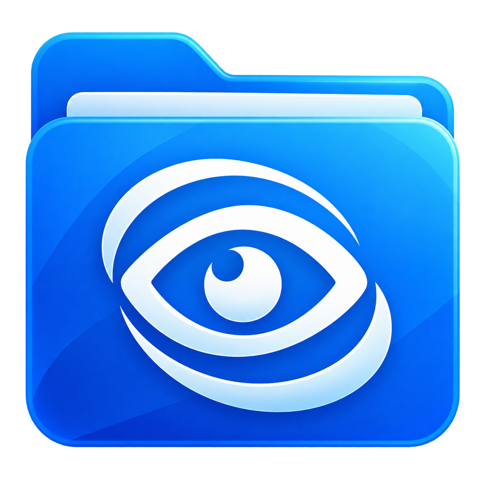

<div align="center">



# 🔍 Insight Similar Folder Finder
### Smart Duplicate Folder & File Finder with AI-Assisted Matching & Deep Safety Guard
**Version 1.6.0 — Enterprise-Grade Accuracy, Archive Protection & Intelligent Perceptual Matching**

[](https://github.com/alarifi/insight-similar-folder-finder/releases/tag/v1.6.0)
[-00a4ef.svg?style=for-the-badge&logo=windows)](https://github.com/alarifi/insight-similar-folder-finder)
[](https://dotnet.microsoft.com/)
[](https://www.insight-ye.com)
[](https://www.insight-ye.com)

<p align="center">
  <b>برنامج احترافي متقدم للبحث عن المجلدات والملفات المكررة والمتشابهة، مدعوم بالذكاء الاصطناعي وخوارزميات المطابقة الإدراكية مع أقصى درجات الأمان وحماية البيانات.</b><br>
  An intelligent, next-generation duplicate and similar directory/file analyzer powered by perceptual hashing, acoustic FFT fingerprinting, document text similarity, and non-destructive archival workflows.
</p>

---

</div>

## 📸 Interface Preview | واجهة البرنامج

<div align="center">

### 🖥️ Main Dashboard & Deep Inspection View


<p align="center">
  <i>واجهة حديثة عالية السرعة مبنية بتقنية WPF مع شجرة مجلدات تفاعلية، تصنيف دقيق، ومعاينة متكاملة قبل أي إجراء.</i>
</p>

</div>

---

## 🌟 Superpowers & Competitive Advantages | المزايا التنافسية الحصرية

### 🇸🇦 المميزات الحصرية (بالعربية)

1. 🎯 **مطابقة المحتوى الحقيقي (Content-First Matching)**:
   - يكتشف الملفات والمجلدات المتطابقة حتى لو **اختلفت الأسماء كلياً** أو تغيرت المسارات أو تواريخ الإنشاء.
   - يعتمد على تجزئة تشفيرية متدفقة **SHA-256 (Streaming Cryptographic Hashing)** تضمن دقة بنسبة 100% دون أي نسبة خطأ.

2. 🧠 **محرك الذكاء الاصطناعي والمطابقة الإدراكية (AI & Perceptual Matching)**:
   - **الصور المتشابهة (pHash)**: كشف الصور المكررة حتى مع اختلاف المقاسات، درجات الضغط، أو اختلاف الامتداد (JPG, PNG, WebP).
   - **الصوت والفيديو الذكي (Acoustic FFT & Video Sampling)**: بصمة طيفية للصوت وعينات إطارات مستقلة عن الدقة لاكتشاف نفس الفيديو أو المقطع الصوتي بجودات وصيغ مختلفة عبر مكتبات FFmpeg المدمجة.
   - **التشابه النصي للمستندات**: استخراج النصوص وتحليلها داخل ملفات Word (`.docx`)، Excel (`.xlsx`)، PowerPoint (`.pptx`)، وملفات PDF (عبر MuTool) ونصوص TXT/Markdown/JSON بذكاء شنجلز 3-gram ومعامل Dice.
   - **المطابقة الذكية للنصوص والأسماء العربية**: معالجة متقدمة لأسماء الملفات العربية (توحيد الألفات والهمزات، إزالة التشكيل والتطويل، توحيد الأرقام) لاكتشاف المكررات دون تعديل أسماء الملفات على القرص.

3. 🛡️ **أمان استثنائي وضمانة عدم الحذف الخاطئ (Zero-Destruction Guard)**:
   - **حماية النتائج المبنية على التشابه (Review-Only Safety Lock)**: نتائج تشابه الصور والمستندات والفيديو تُقفل تماماً للحماية وتُخصص للمعاينة فقط، ويُمنع منعاً باتاً حذفها أو أتمتة مسحها لضمان عدم فقدان أي ملف ثمين.
   - **اختيار النسخة الأفضل تلقائياً (Quality-First Best Keeper)**: خوارزمية ذكية تفحص دقة الصور والفيديو ونظافة الاسم وتحدد تلقائياً النسخة الأعلى جودة لحمايتها كنسخة أصلية (Keeper).
   - **النقل الآمن للأرشيف (Safe Move to Archive)**: خيار بديل للحذف، يقوم بنقل الملفات المكررة إلى مجلد أرشيف مخصص مع **الحفاظ التام على الهيكل الشجري الأصلي للمجلدات**.
   - **خزنة الاسترجاع وسلة المحذوفات (Recovery Vault & Undo)**: أي عملية حذف اختيارية تذهب إلى سلة المحذوفات مع سجل SQLite متكامل يسمح بالتراجع التام بنقرة واحدة (Reversible Undo).
   - **المعاينة المتكاملة قبل أي قرار**: فحص عميق للصور، المستندات، الأصوات، والفيديوهات مباشرة من داخل البرنامج قبل تنفيذ أي إجراء.

---

### 🇬🇧 English Overview & Architectural Invariants

- **Cryptographic Byte Verification**: Absolute byte-for-byte equality powered by streaming SHA-256 with smart size pre-grouping. Identifies duplicates regardless of file or directory naming.
- **Acoustic & Perceptual Media Engine**: 32-dimensional Cooley-Tukey Radix-2 FFT spectral energy analysis across mono PCM audio streams, paired with 64-bit DCT perceptual hashing across video keyframes.
- **Office & PDF Deep Inspection**: Extracts and computes similarity across DOCX, XLSX, PPTX, PDF (via bundled `mutool`), and plain text without Office Interop or cloud dependencies.
- **Linguistic Arabic Normalization**: FormKC normalization, Alef unification (`أ`, `إ`, `آ`, `ٱ` → `ا`), digit normalization, and diacritic/tatweel stripping strictly isolated for candidate discovery.
- **Automated Quality-First Keeper Engine**: Evaluates pixel resolution (`Width * Height`), bitrate, and naming heuristics (` - Copy`, `(1)`, `_backup`, `نسخة من`) to preserve the highest-quality file.
- **Non-Destructive Archiving**: Moves duplicates to an archive target directory while strictly preserving deep folder hierarchies.
- **Zero-Cloud & 100% Offline**: Zero internet telemetry, zero background connections. Your sensitive files and directory trees stay 100% private on your machine.

---

## 💾 Downloads | روابط التحميل

| الإصدار / الحزمة | نوع الملف | الحجم | الوصف | التحميل المباشر |
| :--- | :---: | :---: | :--- | :---: |
| **Insight Similar Folder Finder Setup** | `.exe` (Installer) | ~49.2 MB | برنامج التثبيت الرسمي لنظام ويندوز مع التكامل بقائمة كليك يمين وقائمة ابدأ | [⬇️ تحميل التثبيت الرسمي (Setup.exe)](https://github.com/alarifi/insight-similar-folder-finder/releases/download/v1.6.0/Insight_Similar_Folder_Finder_v1.6.0_Setup.exe) |
| **Insight Similar Folder Finder Portable** | `.zip` (Portable) | ~59.8 MB | نسخة محمولة كاملة تحتوي على كافة المكتبات المدمجة جاهزة للتشغيل المباشر | [⬇️ تحميل النسخة المحمولة (Portable.zip)](https://github.com/alarifi/insight-similar-folder-finder/releases/download/v1.6.0/Insight_Similar_Folder_Finder_v1.6.0_Portable.zip) |

---

## 🔒 Verification & Hashes (SHA-256)

```text
Setup Installer:
Insight_Similar_Folder_Finder_v1.6.0_Setup.exe

Portable Archive:
Insight_Similar_Folder_Finder_v1.6.0_Portable.zip (SHA256 in SHA256SUMS.txt)
```

---

## 💻 System Requirements | متطلبات التشغيل

- **Operating System**: Windows 11 / Windows 10 (64-bit).
- **Runtime**: .NET Desktop Runtime 10.0 (x64) — (Self-contained tools included).
- **RAM**: 4 GB RAM recommended for massive directory scanning.
- **Storage**: ~150 MB free disk space.
- **Permissions**: Standard user permissions (Administrator privilege only required during installer setup for Shell context menu registration).

---

## 🏢 Publisher & Support | المطور والدعم الفني

Developed and published with pride by **INSIGHT Tools**.
- **Official Website**: [https://www.insight-ye.com](https://www.insight-ye.com)
- **Repository**: [alarifi/insight-similar-folder-finder](https://github.com/alarifi/insight-similar-folder-finder)
- **Feedback & Issues**: Please report any bugs or submit feature suggestions via GitHub Issues.

---

<div align="center">
  <sub>Copyright © 2026 INSIGHT Tools. All rights reserved.</sub>
</div>
